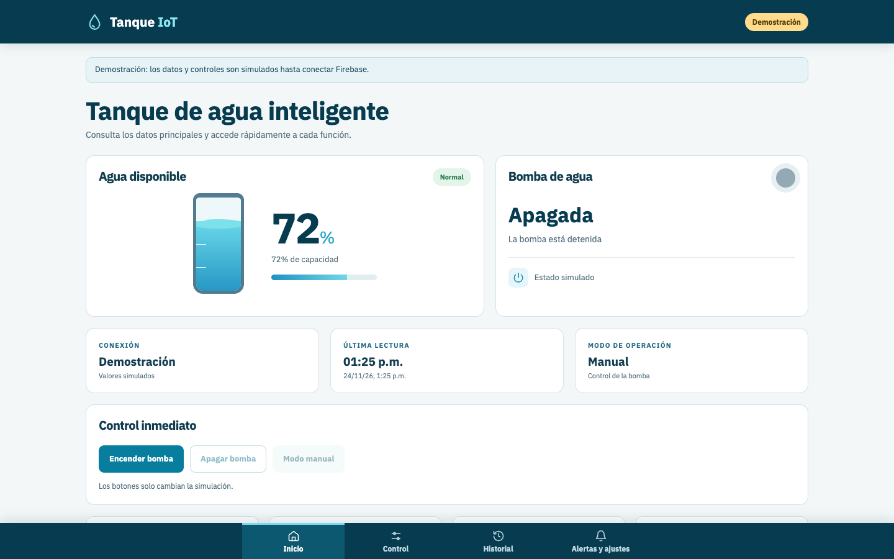
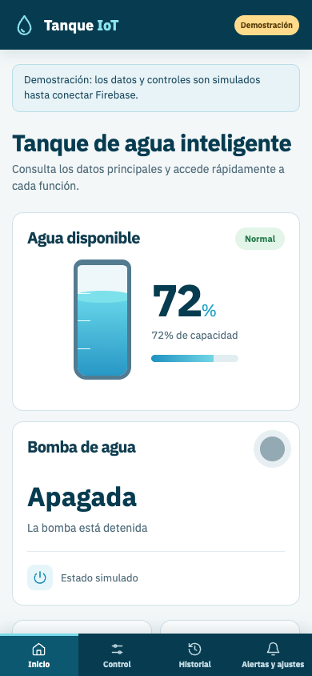
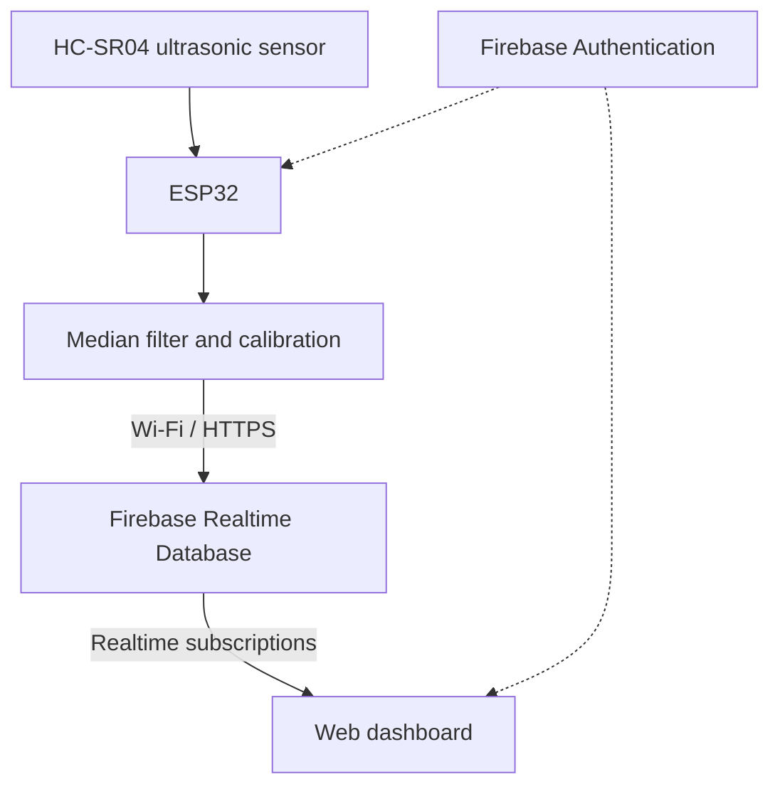

# IoT Water Tank Monitor

University team project for monitoring water stored in a small prototype tank using an ESP32, an HC-SR04 ultrasonic sensor, Firebase Realtime Database and a responsive web dashboard.

## Project status

As of November 24, 2026, the repository contains the dashboard, ESP32 firmware and Firebase security rules. The firmware includes reported physical calibration references and authenticated cloud communication. End-to-end operation, measurement accuracy, repeatability and deployed database rules still require documented verification.

- **Implemented in source:** distance filtering, volume estimation, Wi-Fi connectivity, authenticated database updates, live dashboard subscriptions, demonstration mode and CSV export.
- **Pending validation:** physical accuracy, long-running connectivity, authorization behavior and deployment.
- **Not implemented in the physical prototype:** pump control and persistent measurement history. Dashboard controls and history can be demonstrated in simulation; live optional paths require additional integration.

## Dashboard preview

| Desktop | Mobile |
| --- | --- |
|  |  |

These are repository interface previews, not evidence of live hardware operation.

## System architecture



The sensor measures the gap between its transducers and the water surface. As water rises, distance decreases. The firmware rejects invalid echoes, filters five samples and uses piecewise linear interpolation to estimate volume. Valid readings are uploaded approximately every five seconds when connectivity and authentication permit.

## Hardware and software

| Component | Technology |
| --- | --- |
| Microcontroller | ESP32, Arduino C++ |
| Distance sensor | HC-SR04 |
| Sensor connections | TRIG GPIO 18; ECHO GPIO 19 through a voltage divider |
| Prototype usable capacity | 2 L, according to the current calibration table |
| Communication | Wi-Fi, HTTPS with TLS certificate validation |
| Cloud storage | Firebase Realtime Database |
| Authentication | Firebase Authentication |
| Frontend | HTML, CSS, JavaScript, Vite |
| Version control | Git and GitHub |

**Electrical precaution:** never connect a 5 V HC-SR04 ECHO output directly to an ESP32 GPIO. Use a suitable voltage divider or level shifter, common ground and keep electronics dry. See [hardware notes](docs/hardware.md).

## Calibration

The firmware contains the following reported volume/distance references from November 24, 2026.

| Volume (L) | Distance (cm) |
| ---: | ---: |
| 0.00 | 20.56 |
| 0.25 | 17.29 |
| 0.50 | 15.98 |
| 0.75 | 13.93 |
| 1.00 | 11.54 |
| 1.25 | 8.82 |
| 1.50 | 7.82 |
| 1.75 | 4.92 |
| 2.00 | 2.98 |

Volume percentage is calculated relative to the 2 L usable capacity; height percentage is calculated from the distance endpoints. These are different quantities. Calibration points do not establish measurement uncertainty, and changing the sensor position requires recalibration.

## Repository structure

```text
iot-water-tank/
├── dashboard/
│   ├── src/
│   ├── public/
│   ├── preview/
│   ├── index.html
│   ├── package.json
│   ├── package-lock.json
│   └── .env.example
├── database/
│   ├── firebase.rules.json
│   └── firebase.rules.template.json
├── firmware/
│   └── Tanque_agua.ino/
│       ├── Tanque_agua.ino.ino
│       ├── tank_processing.h
│       ├── firebase_config.h
│       ├── firebase_ca.h
│       ├── wifi_config.example.h
│       └── firebase_device_secret.example.h
├── docs/
├── tests/
└── README.md
```

## Getting started

### 1. Run the dashboard

Install a Node.js version compatible with the Vite dependency in the package manifest, then run:

```bash
git clone https://github.com/Alejandro-strada/iot-water-tank.git
cd iot-water-tank/dashboard
npm ci
npm run dev
```

Open the local URL printed by Vite. With no Firebase configuration, the application can run in demonstration mode. For live operation:

```bash
cp .env.example .env.local
```

Review and configure the Firebase project identifiers and database paths in the local file, then restart Vite. Live access requires an authenticated identity authorized by the database rules. The current dashboard attempts anonymous authentication, but a newly generated UID is not automatically authorized. Provision an authorized browser identity and configure the login flow or rules appropriately; do not make the database publicly readable.

Build the frontend with `npm run build` and inspect the build with `npm run preview`. The repository itself does not provide a deployed website.

### 2. Configure Firebase

Create or use an authorized Firebase project with Realtime Database and Authentication. Review [the rules template](database/firebase.rules.template.json), replace identity placeholders with the intended device and viewer UIDs, and apply the reviewed rules in Firebase Console. Configure the appropriate authentication providers.

The supplied [rules](database/firebase.rules.json) restrict tank reads to specific authenticated identities, allow the designated device to write current readings and validate measurement fields. Configuration writes are denied to clients. Verify the deployed rules separately.

| Database path | Purpose |
| --- | --- |
| `tanque/actual/llenadoPorcentaje` | Estimated volume percentage |
| `tanque/actual/nivelAlturaPorcentaje` | Height percentage |
| `tanque/actual/litros` | Estimated liters |
| `tanque/actual/distanciaCm` | Filtered distance |
| `tanque/actual/actualizadoEn` | Server timestamp |
| `tanque/configuracion/capacidadLitros` | Configured capacity; provision as administrator |

The firmware updates the current record rather than storing an append-only measurement history. Without a configured history path, the dashboard retains readings only during the current page session. Git stores the rules and source code, not live Firebase records.

### 3. Configure the ESP32

1. Install Arduino IDE and ESP32 board support.
2. Open [the sketch](firmware/Tanque_agua.ino/Tanque_agua.ino.ino) and select the appropriate board and serial port.
3. Copy `wifi_config.example.h` to `wifi_config.h` and enter local Wi-Fi credentials.
4. Copy `firebase_device_secret.example.h` to `firebase_device_secret.h` and provision the authorized device refresh token privately. Review `firebase_config.h` for the target project.
5. Confirm the device UID is authorized in the database rules, wire the sensor safely and upload the sketch.
6. Open the serial monitor at 115200 baud and check calibration status, Wi-Fi connectivity, valid readings and Firebase HTTP responses.

## Security

Keep Wi-Fi passwords, refresh tokens, device identity files and local environment files out of Git. Firebase client API keys identify the project and do not independently grant database access; enforce authentication, appropriate API restrictions and database rules. Do not publish private credentials or loosen access rules to bypass authentication errors.

## Documentation and validation

The following supporting documents include earlier planning material and may lag behind the current implementation; this README describes the current source code.

- [Architecture](docs/architecture.md)
- [Hardware and wiring](docs/hardware.md)
- [Container and calibration](docs/calibration.md)
- [Technical decisions](docs/decisions.md)
- [Development roadmap](docs/roadmap.md)
- [Firmware notes](firmware/README.md)
- [Dashboard notes](dashboard/README.md)
- [Test plan](tests/README.md)

Next steps: validate repeated measurements against known volumes, test rejected echoes and reconnect behavior, verify live authentication and database permissions, document build results and deploy the dashboard if required.

## Team and reference repository

- **Alejandro Estrada** — repository owner.
- **Alfonso Carranza** — teammate; maintains [iot-water-tank-monitor](https://github.com/AlfonsoCaBa/iot-water-tank-monitor).

Earlier planning referenced Alfonso's repository at [commit d2ad9a0](https://github.com/AlfonsoCaBa/iot-water-tank-monitor/commit/d2ad9a06b27a0a1791f8e021465136d35e3d9df2). The complete team roster and responsibilities remain to be recorded.

This is an educational monitoring prototype, not a certified household water management or drinking-water quality system.
